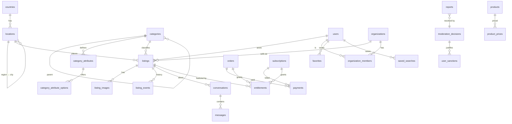

# Database schema

Oct 16, 2026 · Phase 2 design · **Status: approved Oct 16, 2026** (with the answers in section 16)

PostgreSQL 18 + PostGIS 3.6. This is the full schema for the marketplace, including the payment and moderation tables that features will only use later. It is implemented in `src/db/schema/` and `src/db/migrations/` (section 17). This file is the reference for the Drizzle schema in `src/db/`, and every later change to it goes through a migration and an update here.

It builds on the ten decisions in `docs/architecture.md` ("Database design") and on `docs/setup.md` (PostgreSQL 18 `uuidv7()`, Telegram-first phone verification, R2 storage keys).

## 1. Decisions

The ten decisions from the plan are kept. These are the additional choices this design makes. Each is explained where it applies.

1. **36 tables in one `public` schema.** Each table belongs to one module (section 3). Modules read another module's tables only through that module's code, not through their own queries. Foreign keys across modules are fine because it is one database.
2. **Status columns are `text` + `CHECK`, not PostgreSQL `ENUM` types.** Drizzle's `text({ enum: [...] })` still gives TypeScript types. A value can be added or removed by one migration that replaces the constraint. An `ENUM` value can never be dropped.
3. **The database is created with the built-in `C.UTF-8` collation** (`POSTGRES_INITDB_ARGS="--locale-provider=builtin --builtin-locale=C.UTF-8"`). Collations from glibc change when the OS image is upgraded, which silently corrupts text indexes. The built-in provider never changes. Persian alphabetical order is needed only for display (city and category lists), so those few queries use `COLLATE "fa-x-icu"`, or the app sorts with `Intl.Collator('fa')`. This must be set before the first `initdb`. It cannot be changed later without a dump and restore.
4. **Browse pages sort by `listings.ranked_at`, not `created_at`.** A draft's creation time is not when the listing appeared, and paid bumps have to move a listing up. `ranked_at` starts as `published_at` and is moved forward only by the worker when it applies a bump entitlement (section 9). Whether a listing is *featured* is still computed from `entitlements` and never stored on the listing.
5. **Listings point only to leaf categories.** A parent category's page queries `category_id = ANY($leaf_ids)`, using the category tree cached in Valkey. The tree also has an `ltree` path for SQL-side descendant queries.
6. **Chat read state is one watermark per side** (`buyer_last_read_at`, `seller_last_read_at`) plus unread counters on the conversation. There is no `read_at` per message. Reading a conversation is one row update instead of one per message, and "seen" ticks come from comparing a message's time with the other side's watermark.
7. **The "money only through webhooks" rule is enforced by the database.** The Next.js webhook route only stores the raw event (`webhook_events`). The worker, a separate database role, applies it. The app role has no write permission on `payments`, `subscriptions` or `entitlements` (section 13).
8. **Better Auth uses our tables.** `users`, `sessions`, `auth_accounts`, `verifications` and `two_factors` follow Better Auth's model with field mapping. IDs come from the database (`uuidv7()`), not from Better Auth. Phone verification is our own code (Telegram bot plus SMS), not Better Auth's phone plugin.
9. **Drafts may be incomplete.** Category, location and price are required only once a listing leaves `draft`, enforced by `CHECK`s. AI posting (phase 5) needs this: the photo is uploaded before anyone knows the category.
10. **Location integrity uses composite foreign keys.** `(location_id, country_code)` on a listing references `locations (id, country_code)`, so a listing can never claim Germany while pointing at a Swedish city.

## 2. Conventions

| Topic | Rule |
| --- | --- |
| Nullability | **Every column is `NOT NULL` unless its type is marked `null`.** |
| Primary keys | `id uuid PRIMARY KEY DEFAULT uuidv7()` (listed as "standard columns"). Exceptions: join tables (`organization_members`, `favorites`, `user_blocks`) use composite keys, and reference tables (`countries`, `currencies`) use their ISO code. |
| Standard columns | `id`, `created_at timestamptz DEFAULT now()`, and on mutable tables `updated_at timestamptz DEFAULT now()`, kept current by one trigger function `set_updated_at()`. A trigger rather than Drizzle's `$onUpdate`, so raw SQL and scripts can't forget it. |
| Time | `timestamptz` only, in UTC. |
| Strings | `text` with `CHECK (char_length(...) …)`, never `varchar(n)`. |
| Persian text | Each searchable text has `<col>` (original) and `<col>_normalized`, both written by the app's `normalizePersian()`. The normalized copy is not a generated column, because a second implementation in SQL would drift from the TypeScript one. Chat messages are not searched, so they have no normalized copy. |
| Money | `<name>_minor bigint` with `CHECK (>= 0)` plus `currency text REFERENCES currencies(code)`. |
| Public tokens | 10 characters of lowercase Crockford base32, `CHECK (token ~ '^[0-9a-hjkmnp-tv-z]{10}$')`, generated by the app with a cryptographic random generator, `UNIQUE`, regenerated on collision. That is 50 bits: with 10 million listings, a guessed token hits one about once in 100 million tries. Pages behind login (chat, orders) may use the UUID, which is not guessable either but shows when the row was created. |
| Slugs | Latin, `CHECK (slug ~ '^[a-z0-9]+(-[a-z0-9]+)*$')`. |
| Phone numbers | E.164, `CHECK (phone ~ '^\+[1-9][0-9]{6,14}$')`. |
| JSONB | Always `CHECK (jsonb_typeof(col) = 'object')`. The shape is validated by a Zod schema on every write. |
| Generated columns | PostgreSQL 18 makes generated columns `VIRTUAL` by default, and virtual columns can't be indexed. Indexed generated columns are written `STORED` explicitly. |
| Soft delete | Only `listings`, `users` and `organizations`: `deleted_at timestamptz null` plus `status = 'deleted'`, with `CHECK ((status = 'deleted') = (deleted_at IS NOT NULL))` so the two can't disagree. Everything else is deleted for real. |
| Foreign keys | Child rows that mean nothing without their parent use `ON DELETE CASCADE` (images, favorites, members, sessions). Anything that is money, moderation or audit evidence uses `RESTRICT`, so a purge can never delete evidence by accident. A purge job deletes in dependency order. FK columns used in joins or cascades get an index (PostgreSQL doesn't add one automatically). FKs to small reference tables don't. |
| Extensions | `postgis`, `ltree`. Nothing else: `uuidv7()` is built in, and tokens and hashes are made in the app. |
| Storage | Storage keys only (`listings/7f/0192…webp`), never URLs or bucket names. |

**Drizzle notes.** `geography` and `ltree` need small `customType`s. Partial indexes, `CHECK`s, `NULLS NOT DISTINCT` and composite FKs are supported by drizzle-kit. Triggers, the deferrable unique constraint, `SECURITY DEFINER` functions, roles and grants go in custom SQL migrations (`drizzle-kit generate --custom`).

## 3. Tables by module

| Module | Tables |
| --- | --- |
| listings (incl. reference data) | `countries`, `currencies`, `locations`, `categories`, `category_attributes`, `category_attribute_options`, `listings`, `listing_events`, `favorites` |
| media | `listing_images` |
| search | `saved_searches` |
| users | `users`, `sessions`, `auth_accounts`, `verifications`, `two_factors`, `phone_verifications`, `user_blocks` |
| organizations | `organizations`, `organization_members`, `organization_invitations` |
| chat | `conversations`, `messages` |
| moderation | `reports`, `moderation_decisions`, `user_sanctions` |
| payments | `products`, `product_prices`, `billing_customers`, `orders`, `payments`, `subscriptions`, `entitlements`, `webhook_events` |
| shared (`src/db`) | `outbox_events`, `audit_log` |



---

## 4. Reference data: countries, currencies, locations

Seeded from files in Git (`seed/`). The app reads them from a Valkey cache, so they need few indexes.

### `currencies`

| Column | Type | Notes |
| --- | --- | --- |
| `code` | `text` PK | ISO 4217, `CHECK (code ~ '^[A-Z]{3}$')`: EUR, GBP, SEK, CHF, NOK, DKK, PLN… |
| `minor_unit` | `smallint` | Number of decimal places, `CHECK (minor_unit BETWEEN 0 AND 3)`. 2 for all launch currencies. Formatting and Stripe amounts use it. |
| `name_fa` | `text` | «یورو» |
| `symbol` | `text` | € |

### `countries`

| Column | Type | Notes |
| --- | --- | --- |
| `code` | `text` PK | ISO 3166-1 alpha-2, `CHECK (code ~ '^[A-Z]{2}$')` |
| `name_fa` | `text` | «آلمان» |
| `name_local` | `text` | Deutschland |
| `default_currency` | `text` FK → `currencies` | Preselected when posting |
| `phone_prefix` | `text` | `+49`. Only for the phone input. Users' phones may be from any country, so there is no FK from phone numbers. |
| `is_active` | `boolean DEFAULT false` | Countries open for listings |
| `sort_order` | `smallint DEFAULT 0` | |

### `locations`

Regions and cities. Countries live in `countries`, so the tree is country (`country_code`) → region (`parent_id IS NULL`) → city. A separate table for countries keeps `country_code` a real foreign key everywhere.

Standard columns, plus:

| Column | Type | Notes |
| --- | --- | --- |
| `kind` | `text` | `CHECK (kind IN ('region','city'))` |
| `country_code` | `text` FK → `countries` | |
| `parent_id` | `uuid null` | Composite FK `(parent_id, country_code) → locations (id, country_code)`, so a city's region is in the same country |
| `slug` | `text` | Latin: `berlin`, `frankfurt-oder` |
| `name_fa` | `text` | «برلین» |
| `name_fa_normalized` | `text` | For city autocomplete |
| `name_local` | `text` | Berlin, München |
| `center` | `geography(Point,4326)` | City centre. Default point for listings without a precise location. |
| `timezone` | `text` | IANA name, e.g. `Europe/Berlin`. Daily digests go out at a local hour. |
| `population` | `integer null` | Orders city pickers and autocomplete |
| `geonames_id` | `integer null UNIQUE` | Where the seed row came from, so a re-import can match rows |
| `is_active` | `boolean DEFAULT true` | |

Constraints:
- `UNIQUE (id, country_code)`: the target of the composite FKs from `locations.parent_id` and `listings`.
- `CHECK ((kind = 'region') = (parent_id IS NULL))`: regions are roots, cities always have a region. The seed checks that a city's parent is a region. A FK can't express that.

| Index | Serves |
| --- | --- |
| `UNIQUE (slug) WHERE kind = 'city'` | City slugs appear alone in URLs (`/{city}/{category}`), so they must be unique across all countries (`frankfurt` vs `frankfurt-oder`) |
| `UNIQUE (country_code, slug) WHERE kind = 'region'` | Region slugs, unique per country |
| `(parent_id)` | Cities of a region (region pages, seed checks) |
| `GIST (center)` | Nearest city to the user's GPS position: `ORDER BY center <-> $point LIMIT 1` |

---

## 5. Categories and attribute definitions

### `categories`

Standard columns, plus:

| Column | Type | Notes |
| --- | --- | --- |
| `parent_id` | `uuid null` FK → `categories` RESTRICT | |
| `path` | `ltree UNIQUE` | Slugs from the root, e.g. `vehicles.cars`. `ltree` labels allow hyphens since PostgreSQL 16. |
| `slug` | `text UNIQUE` | Globally unique, because it appears alone in `/{city}/{category}` |
| `name_fa` | `text` | «خودرو» |
| `name_fa_normalized` | `text` | Category picker search, AI category matching |
| `description_fa` | `text null` | |
| `icon` | `text null` | Icon name from the design system |
| `allows_listings` | `boolean DEFAULT false` | True for leaves. Listings may only use such categories (checked by the app from the cached tree, plus a seed test). |
| `price_mode` | `text DEFAULT 'required'` | `CHECK IN ('required','optional','none')`. Jobs and services can turn the price off. |
| `listing_duration_days` | `smallint DEFAULT 30` | `CHECK (BETWEEN 1 AND 365)`. Sets `expires_at` when a listing is published. |
| `max_images` | `smallint DEFAULT 12` | `CHECK (BETWEEN 0 AND 30)` |
| `requires_review` | `boolean DEFAULT true` | Review before publishing (Divar's model). Can be relaxed per category and trust score later. |
| `business_only` | `boolean DEFAULT false` | For example, job ads only from organizations |
| `sort_order` | `smallint DEFAULT 0` | |
| `is_active` | `boolean DEFAULT true` | |

Constraint: `CHECK ((parent_id IS NULL) = (nlevel(path) = 1))`.

| Index | Serves |
| --- | --- |
| `GIST (path)` | Descendants (`path <@ 'vehicles'`) and breadcrumbs (`path @> $path`) in admin tools and seed checks |
| `(parent_id, sort_order)` | Children of a category for menus |

Moving a category means updating `path` for its subtree in one statement. Listings reference `id`, so they are unaffected.

### `category_attributes`

The field definitions that `listings.attributes` is validated against. A definition applies to its category **and all descendants**: a car listing gets the fields of `vehicles` plus those of `vehicles.cars`.

Standard columns, plus:

| Column | Type | Notes |
| --- | --- | --- |
| `category_id` | `uuid` FK → `categories` RESTRICT | |
| `key` | `text` | JSON key in `listings.attributes`, `CHECK (key ~ '^[a-z][a-z0-9_]{0,39}$')`: `mileage_km`, `fuel`, `rooms` |
| `type` | `text` | `CHECK IN ('number','select','multi_select','boolean','text')` |
| `label_fa` | `text` | «کارکرد» |
| `unit_fa` | `text null` | «کیلومتر» |
| `help_fa` | `text null` | |
| `validation` | `jsonb DEFAULT '{}'` | Per type: `{min, max, integer}` for numbers, `{max_length}` for text, `{max_items}` for multi-select |
| `depends_on_attribute_id` | `uuid null` FK → `category_attributes` | Dependent selects: `model` depends on `brand` |
| `is_required` | `boolean DEFAULT false` | Required to publish (drafts may lack it) |
| `is_filterable` | `boolean DEFAULT false` | Shown as a filter, sent to Meilisearch as a filterable field |
| `is_searchable` | `boolean DEFAULT false` | Text sent to the Meilisearch index |
| `show_on_card` | `boolean DEFAULT false` | Shown on listing cards (e.g. year · mileage) |
| `sort_order` | `smallint DEFAULT 0` | |
| `is_active` | `boolean DEFAULT true` | Retired fields stay so old listings still display. A key is never reused with a different meaning. |

Constraint: `UNIQUE (category_id, key)`. A key must also be unique along each path (a child can't redefine its parent's `condition`). The database can't express that across the tree, so a seed test checks it.

### `category_attribute_options`

Allowed values for `select` and `multi_select`. A table instead of a JSON array, because car brand and model lists have thousands of entries, need filtering by parent, and must be retirable one by one.

Standard columns, plus:

| Column | Type | Notes |
| --- | --- | --- |
| `attribute_id` | `uuid` FK → `category_attributes` CASCADE | |
| `value` | `text` | What listings store: `diesel`, `bmw`, `bmw-3-series`. Same pattern as `key`, hyphens allowed. |
| `label_fa` | `text` | «دیزل» |
| `parent_option_id` | `uuid null` FK → `category_attribute_options` | The `bmw` option for the `bmw-3-series` model |
| `sort_order` | `smallint DEFAULT 0` | |
| `is_active` | `boolean DEFAULT true` | |

| Index | Serves |
| --- | --- |
| `UNIQUE (attribute_id, value)` | Validation lookups. A value is unique per field. |
| `(attribute_id, parent_option_id, sort_order)` | "Models for brand X" in the posting form |

**How validation works.** On every listing write, the listings module loads the effective definitions for the category (cached in Valkey, invalidated when the seed changes), builds a Zod schema from them and validates `attributes`. Selects store option `value`s, never labels. Numbers are JSON numbers, multi-selects are arrays of values. Unknown keys are rejected. The database only checks that `attributes` is an object. A trigger that re-validates in SQL would duplicate the rules in a second language. A weekly job re-validates active listings against current definitions and reports mismatches (for example after a definition change).

---

## 6. Users, authentication and phone verification

### `users`

People. Better Auth's `user` model is mapped onto this table: `name → display_name`, `emailVerified → email_verified`, `image → avatar_key`. The Google/Apple profile mapper doesn't copy the provider's photo URL, because only storage keys are stored.

Standard columns, plus:

| Column | Type | Notes |
| --- | --- | --- |
| `public_token` | `text UNIQUE` | Public seller profile `/u/{token}` |
| `email` | `text UNIQUE` | `CHECK (email = lower(email))`. Required by Better Auth. Apple's private relay addresses are fine. |
| `email_verified` | `boolean DEFAULT false` | |
| `display_name` | `text` | `CHECK (char_length BETWEEN 1 AND 50)` |
| `display_name_normalized` | `text` | Admin search |
| `avatar_key` | `text null` | Storage key |
| `phone_e164` | `text null UNIQUE` | **Only verified numbers live here.** Pending ones are in `phone_verifications`. |
| `phone_verified_at` | `timestamptz null` | |
| `phone_verification_method` | `text null` | `CHECK IN ('telegram','sms')`: how the current number was verified |
| `telegram_user_id` | `bigint null UNIQUE` | Set by Telegram verification. Lets the bot send notifications (in a private chat, the chat id equals the user id) and allows Telegram login later. |
| `staff_role` | `text null` | `CHECK IN ('moderator','admin')`. Null for normal users. |
| `two_factor_enabled` | `boolean DEFAULT false` | Better Auth `twoFactorEnabled`. Staff without it are refused at login. That rule is in the app, so a role can be granted before the person enrolls. |
| `trust_score` | `smallint DEFAULT 50` | `CHECK (BETWEEN 0 AND 100)`. Computed by the worker (account age, verified phone, upheld reports, sanctions). |
| `home_location_id` | `uuid null` FK → `locations` | Default city for browsing and posting |
| `notification_prefs` | `jsonb DEFAULT '{}'` | Channels and quiet hours, validated by Zod |
| `status` | `text DEFAULT 'active'` | `CHECK IN ('active','deactivated','deleted')` |
| `last_seen_at` | `timestamptz null` | Written at most once an hour |
| `deleted_at` | `timestamptz null` | |

Constraints:
- `CHECK (num_nonnulls(phone_e164, phone_verified_at, phone_verification_method) IN (0, 3))`: a number is never stored without its verification time and method.
- Soft-delete check (section 2).

`status` doesn't cover bans. Bans and restrictions live only in `user_sanctions`, so there is one source of truth and no flag that can drift from it. New-account limits ("first 7 days") come from `created_at`.

Indexes: the four `UNIQUE` constraints (`public_token`, `email`, `phone_e164`, `telegram_user_id`). Every login and profile lookup goes through one of them.

### Better Auth tables

These follow Better Auth's core model with snake_case column names. Better Auth is configured to let the database generate IDs (`advanced.database.generateId: false`, checked with Better Auth 1.7.10: the IDs are PostgreSQL's `uuidv7()`). Better Auth's admin and organization plugins are **not** used: bans are `user_sanctions`, businesses are our own `organizations`.

**`sessions`** (device list: "logged-in devices, log out each one"). Standard columns, plus `user_id uuid` FK → `users` CASCADE, `token text UNIQUE`, `expires_at timestamptz`, `ip_address text null`, `user_agent text null`. `ip_address` is `text` because Better Auth writes whatever the request gives it.

| Index | Serves |
| --- | --- |
| `UNIQUE (token)` | Session lookup on every request |
| `(user_id)` | Device list, "log out everywhere" |
| `(expires_at)` | Cleanup of expired sessions |

**`auth_accounts`** (Better Auth `account`: Google, Apple). Standard columns, plus `user_id` FK CASCADE, `provider_id text`, `account_id text` (the provider's user id), `access_token text null`, `refresh_token text null`, `id_token text null`, `access_token_expires_at`, `refresh_token_expires_at`, `scope text null`, `password text null` (always null: no passwords). Better Auth's OAuth-token encryption is turned on. Indexes: `UNIQUE (provider_id, account_id)` (login), `(user_id)`.

**`verifications`** (Better Auth `verification`: email login codes). Standard columns, plus `identifier text`, `value text`, `expires_at`. A login code is one row with identifier `sign-in-otp-<email>` and value `<SHA-256 of the code>:<wrong attempts>`; the code itself is never stored. Indexes: `(identifier)` (code check), `(expires_at)` (cleanup).

**`two_factors`** (Better Auth two-factor plugin, required for staff). Standard columns, plus `user_id` FK CASCADE `UNIQUE`, `secret text`, `backup_codes text`. Both are encrypted by Better Auth.

### `phone_verifications`

Every attempt to verify a phone number, by either method. Valkey counters do the rate limiting. This table is the durable record behind them and stores which method verified the number.

Standard columns (no `updated_at`; status changes are rare and timestamped), plus:

| Column | Type | Notes |
| --- | --- | --- |
| `user_id` | `uuid` FK → `users` CASCADE | |
| `method` | `text` | `CHECK IN ('telegram','sms')` |
| `status` | `text DEFAULT 'pending'` | `CHECK IN ('pending','verified','failed','expired')` |
| `phone_e164` | `text null` | SMS: the number typed in. Telegram: unknown until the contact is shared, then taken from it. |
| `link_token_hash` | `bytea null UNIQUE` | Telegram: SHA-256 of the random token in the `t.me/<bot>?start=<token>` link. Ties the bot chat to this user. |
| `telegram_user_id` | `bigint null` | Set when the link is opened (`/start <token>`): the first Telegram account to open it claims the attempt, and only that account's contact counts. **The contact is accepted only when `contact.user_id` equals the sender's `from.id`** (setup.md, decision 5). Otherwise status is `failed` with `failure_reason = 'foreign_contact'`. |
| `code_hash` | `bytea null` | SMS: HMAC-SHA256 of the 6-digit code with a server secret. The code itself is never stored. |
| `attempts` | `smallint DEFAULT 0` | Wrong SMS codes, `CHECK (attempts BETWEEN 0 AND 10)`. Fails at 5. |
| `sms_provider` | `text null` | |
| `provider_message_id` | `text null` | Delivery receipts, cost reconciliation |
| `failure_reason` | `text null` | `foreign_contact`, `phone_in_use`, `telegram_in_use` (the Telegram account is linked to another user), `too_many_attempts`, `undeliverable` |
| `ip_address` | `inet null` | Abuse investigations. Deleted with the row after 90 days. |
| `expires_at` | `timestamptz` | SMS code: 10 minutes. Telegram link: 15 minutes. |
| `verified_at` | `timestamptz null` | |

Constraints:
- `CHECK (method <> 'sms' OR (phone_e164 IS NOT NULL AND code_hash IS NOT NULL))`
- `CHECK (method <> 'telegram' OR link_token_hash IS NOT NULL)`
- `CHECK (status <> 'verified' OR (verified_at IS NOT NULL AND phone_e164 IS NOT NULL))`
- `CHECK (method <> 'telegram' OR status <> 'verified' OR telegram_user_id IS NOT NULL)`

On success, **one transaction** marks the row `verified`, sets `users.phone_e164`, `phone_verified_at`, `phone_verification_method` (and `telegram_user_id` for Telegram), and writes an `audit_log` row. If another account already has the number, the attempt fails with `phone_in_use`, and support can release the number. Phone numbers get recycled, so refusing is safer than silently moving the number to the new account.

| Index | Serves |
| --- | --- |
| `UNIQUE (link_token_hash)` | The bot finding the attempt from `/start <token>` |
| `(user_id, created_at DESC)` | The user's latest attempt, per-user limits |
| `(phone_e164, created_at DESC) WHERE method = 'sms'` | Per-number SMS limits against SMS-pumping fraud, and investigations |

### `user_blocks`

A user blocks another user: no more messages in either direction.

| Column | Type | Notes |
| --- | --- | --- |
| `blocker_user_id` | `uuid` FK → `users` CASCADE | PK part 1 |
| `blocked_user_id` | `uuid` FK → `users` CASCADE | PK part 2. `CHECK (blocker_user_id <> blocked_user_id)` |
| `created_at` | `timestamptz DEFAULT now()` | |

Indexes: the PK `(blocker_user_id, blocked_user_id)`, plus `(blocked_user_id)`. Before a message is sent, both directions are checked.

---

## 7. Organizations (Pro businesses)

### `organizations`

Standard columns, plus:

| Column | Type | Notes |
| --- | --- | --- |
| `slug` | `text UNIQUE` | Business page `/b/{slug}`. Businesses are public, so a readable slug is fine. |
| `name` | `text` | Display name, `CHECK (char_length BETWEEN 2 AND 80)` |
| `name_normalized` | `text` | |
| `legal_name` | `text null` | |
| `vat_id` | `text null` | EU VAT ID |
| `registration_number` | `text null` | E.g. Handelsregister number |
| `country_code` | `text` FK → `countries` | |
| `location_id` | `uuid null` | Composite FK `(location_id, country_code) → locations (id, country_code)` |
| `address_line1`, `address_line2`, `postal_code` | `text null` | |
| `point` | `geography(Point,4326) null` | Exact: a shop's address is public, unlike a private seller's |
| `phone_e164` | `text null` | Public business phone |
| `email` | `text null` | Public contact email |
| `website` | `text null` | `CHECK (website ~ '^https://')` |
| `description` / `description_normalized` | `text DEFAULT ''` | `CHECK (char_length(description) <= 5000)` |
| `logo_key`, `cover_key` | `text null` | Storage keys |
| `verification_status` | `text DEFAULT 'unverified'` | `CHECK IN ('unverified','pending','verified','rejected')`. "Business verification" is where the plan wants to beat Kleinanzeigen. |
| `verified_at` | `timestamptz null` | |
| `verified_by_user_id` | `uuid null` FK → `users` | |
| `status` | `text DEFAULT 'active'` | `CHECK IN ('active','suspended','deleted')`. Suspension is set together with a `moderation_decisions` row. |
| `created_by_user_id` | `uuid` FK → `users` | |
| `deleted_at` | `timestamptz null` | |

Whether a business is Pro is **not a column**: it is an active `pro_plan` entitlement.

| Index | Serves |
| --- | --- |
| `UNIQUE (slug)` | Business page |
| `UNIQUE (country_code, vat_id) WHERE vat_id IS NOT NULL` | One account per VAT ID, so a business can't open a second account to get the free quota again |
| `(created_at) WHERE verification_status = 'pending'` | Verification queue, oldest first |

### `organization_members`

| Column | Type | Notes |
| --- | --- | --- |
| `organization_id` | `uuid` FK → `organizations` CASCADE | PK part 1 |
| `user_id` | `uuid` FK → `users` CASCADE | PK part 2 |
| `role` | `text` | `CHECK IN ('owner','manager','staff')`. Owner: billing and members. Manager: all listings and chats of the business. Staff: their own listings and the chats about them. |
| `invited_by_user_id` | `uuid null` FK → `users` | |
| `created_at`, `updated_at` | `timestamptz` | |

Indexes: the PK `(organization_id, user_id)` (permission checks, member list), plus `(user_id)` ("my businesses" switcher). The rule "at least one owner" is enforced in the app: the transaction that removes or demotes an owner first locks the organization row (`SELECT … FOR UPDATE`) and counts the owners.

### `organization_invitations`

Standard columns, plus `organization_id` FK CASCADE, `email text null`, `phone_e164 text null` (`CHECK (num_nonnulls(email, phone_e164) = 1)`), `role text` (same values as members), `token_hash bytea UNIQUE`, `invited_by_user_id` FK, `expires_at`, `accepted_at null`, `accepted_by_user_id null`, `revoked_at null`.

Indexes: `UNIQUE (token_hash)` (accepting the link), and `(organization_id) WHERE accepted_at IS NULL AND revoked_at IS NULL` (pending invitations list).

---

## 8. Listings

### `listings`

Standard columns, plus:

| Column | Type | Notes |
| --- | --- | --- |
| `public_token` | `text UNIQUE` | `/v/{persian-title}/{token}`. The title in the URL comes from the title, is not stored and is not checked. |
| `user_id` | `uuid` FK → `users` RESTRICT | The person who posted, always with a verified phone (the app checks that before publishing) |
| `organization_id` | `uuid null` FK → `organizations` RESTRICT | Set when posted for a business, which is then the displayed seller. The app checks membership when the listing is written. There is deliberately no FK to `organization_members`, so the listing stays with the business when the staff member leaves. |
| `category_id` | `uuid null` FK → `categories` RESTRICT | Leaf category. Null only in drafts. |
| `kind` | `text DEFAULT 'offer'` | `CHECK IN ('offer','wanted')`: Divar's «درخواستی», Kleinanzeigen's "Gesuch" |
| `title` | `text DEFAULT ''` | `CHECK (char_length(title) <= 90)` |
| `title_normalized` | `text DEFAULT ''` | |
| `description` | `text DEFAULT ''` | `CHECK (char_length(description) <= 5000)` |
| `description_normalized` | `text DEFAULT ''` | |
| `attributes` | `jsonb DEFAULT '{}'` | Category fields, validated against `category_attributes` (section 5) |
| `price_type` | `text DEFAULT 'fixed'` | `CHECK IN ('fixed','negotiable','free','exchange','on_request')`. «مقطوع», «قابل مذاکره», «رایگان», «معاوضه», «توافقی» |
| `price_minor` | `bigint null` | `CHECK (price_minor >= 0)` |
| `currency` | `text null` FK → `currencies` | Usually the country's default, but can be changed (EUR in Switzerland) |
| `country_code` | `text null` FK → `countries` | Null only in drafts |
| `location_id` | `uuid null` | City. Composite FK `(location_id, country_code) → locations (id, country_code)`. The app checks that it is a city. |
| `point` | `geography(Point,4326) null` | **Never the exact point.** Either the city centre, or the seller's point snapped by the app to the centre of a ~500 m grid cell (latitude step 0.0045°, longitude step 0.0045°/cos(latitude)) before it is written. The exact coordinates are never sent to the database. |
| `location_precision` | `text null` | `CHECK IN ('city','area')`. The page shows either the city or a ~500 m circle. |
| `shipping_offered` | `boolean DEFAULT false` | "Ships" filter for country-wide browsing (the audience is spread out) |
| `allow_phone_contact` | `boolean DEFAULT false` | Phone hidden by default. Chat is always available. |
| `status` | `text DEFAULT 'draft'` | `CHECK IN ('draft','pending_review','active','paused','sold','expired','rejected','deleted')` |
| `status_changed_at` | `timestamptz DEFAULT now()` | Moderation queue order, grace period before "gone" status for SEO |
| `published_at` | `timestamptz null` | First time it became `active` |
| `ranked_at` | `timestamptz null` | Sort key of browse pages (decision 4) |
| `expires_at` | `timestamptz null` | `published_at + categories.listing_duration_days`, extended by renewal |
| `revision` | `integer DEFAULT 1` | Increases with each content edit. Moderation decisions record which revision they judged. |
| `view_count` | `bigint DEFAULT 0` | Counted in Valkey, written here in batches |
| `deleted_at` | `timestamptz null` | |

Constraints:

```sql
-- what a non-draft listing must have
CHECK (status = 'draft' OR (
  category_id IS NOT NULL AND country_code IS NOT NULL AND location_id IS NOT NULL
  AND point IS NOT NULL AND location_precision IS NOT NULL
  AND char_length(title) >= 3))

-- price and currency come together; fixed/negotiable need a price, the others have none
CHECK ((price_minor IS NULL) = (currency IS NULL))
CHECK (status = 'draft' OR (price_type IN ('fixed','negotiable')) = (price_minor IS NOT NULL))

-- an active listing is fully dated
CHECK (status <> 'active' OR num_nonnulls(published_at, ranked_at, expires_at) = 3)

-- soft delete
CHECK ((status = 'deleted') = (deleted_at IS NOT NULL))
```

Category rules the database can't see (`price_mode = 'none'`, `business_only`, required attributes, minimum description length to publish) are checked by the listings module.

Storage: `WITH (fillfactor = 90)`, so the frequent `view_count` updates (on an unindexed column) can stay on the same page (HOT updates) and don't touch the indexes.

**Lifecycle.** `draft → pending_review → active`. Rejected listings can be edited and resubmitted (`rejected → pending_review`). From `active`: `paused` ↔ `active`, `sold`, `expired` (worker, at `expires_at`), `rejected` (moderation after publication; `moderation_decisions` holds the reason). Any state → `deleted`. Every change writes a `listing_events` row in the same transaction, and also an `outbox_events` row when search or notifications need to know.

**Indexes.** All browse indexes are partial on `status = 'active'`. Drafts, expired, sold and deleted listings pile up forever, and leaving them out keeps these indexes small. This is the plan's `(status, category_id, created_at DESC)` with `status` moved into the `WHERE` and `created_at` replaced by `ranked_at`. Each browse index ends with `id DESC` for stable keyset pagination (`WHERE (ranked_at, id) < ($t, $id)`).

| Index | Serves |
| --- | --- |
| `UNIQUE (public_token)` | Listing page |
| `(country_code, category_id, ranked_at DESC, id DESC) WHERE status = 'active'` | Country-wide category pages ("cars in Germany"). For a parent category, `category_id = ANY($leaf_ids)`. **(Plan index 1.)** |
| `(location_id, category_id, ranked_at DESC, id DESC) WHERE status = 'active'` | `/{city}/{category}`, the main browse page in a city-first site |
| `(location_id, ranked_at DESC, id DESC) WHERE status = 'active'` | `/{city}` with all categories: the city home page, the most visited page |
| `GIST (point) WHERE status = 'active'` | Radius search, `ST_DWithin(point, $p, $meters)`, and "nearest first" (`ORDER BY point <-> $p`). **(Plan index 2.)** |
| `GIN (attributes jsonb_path_ops) WHERE status = 'active'` | Attribute filters such as `attributes @> '{"fuel":"diesel","gearbox":"automatic"}'`. `jsonb_path_ops` is about a third the size of the default operator class and serves exactly `@>`. Range filters (`mileage_km < 100000`) aren't served by GIN: within a city and category the row set is small enough to filter, and Meilisearch takes over range filters when search arrives. If measurements show a hot numeric field, add a single expression index for it. **(Plan index 3.)** |
| `(user_id, created_at DESC)` | "My listings", new-account limits ("posts in the last 24 hours"), "other listings by this user" in moderation |
| `(organization_id, ranked_at DESC) WHERE status = 'active' AND organization_id IS NOT NULL` | Business page listing grid |
| `(expires_at) WHERE status = 'active'` | Expiry job, "expires in 3 days, renew?" reminders |
| `(status_changed_at) WHERE status = 'pending_review'` | Moderation queue, oldest first |
| `(deleted_at) WHERE status = 'deleted'` | Retention purge |

Cards on a browse page also need the cover image and featured badge. Both come from batched lookups for the 24 listing IDs on the page (`listing_images` and `entitlements` indexes), not from columns on `listings`.

Global (all-countries) category pages are rare. They use the first index with a sort, which is acceptable at our size.

### `listing_events`

Append-only history of each listing. Used for disputes ("he changed the price after we agreed"), for the explanation owed to a user when content is removed, and for support.

| Column | Type | Notes |
| --- | --- | --- |
| `id` | `uuid` PK `DEFAULT uuidv7()` | |
| `listing_id` | `uuid` FK → `listings` CASCADE | Purged only together with the listing |
| `event_type` | `text` | `CHECK IN ('created','submitted','published','edited','paused','resumed','sold','expired','renewed','bumped','rejected','restored','deleted')` |
| `actor_type` | `text` | `CHECK IN ('user','staff','system','ai','payment')` |
| `actor_user_id` | `uuid null` FK → `users` | |
| `from_status`, `to_status` | `text null` | Same values as `listings.status` |
| `revision` | `integer` | Listing revision after the event |
| `data` | `jsonb DEFAULT '{}'` | Changed fields with old and new values (`{"price_minor": [450000, 420000]}`), reason codes, the entitlement id for `bumped` |
| `moderation_decision_id` | `uuid null` FK → `moderation_decisions` RESTRICT | For `published`, `rejected`, `restored` caused by moderation |
| `created_at` | `timestamptz DEFAULT now()` | |

Index: `(listing_id, created_at)`, the history of one listing. Append-only is enforced by permissions (section 13).

### `listing_images`

Standard columns, plus:

| Column | Type | Notes |
| --- | --- | --- |
| `listing_id` | `uuid` FK → `listings` CASCADE | A draft exists before the first upload, also for AI posting |
| `uploader_user_id` | `uuid` FK → `users` | For business listings: which staff member |
| `position` | `smallint` | 0 is the cover. `CHECK (position BETWEEN 0 AND 29)` |
| `storage_key` | `text UNIQUE` | The upload key while `pending_upload` or `processing`, then the key of the processed master (EXIF removed, re-encoded). The worker deletes the original object. imgproxy makes every size on demand from the master, so no size variants are stored. |
| `status` | `text DEFAULT 'pending_upload'` | `CHECK IN ('pending_upload','processing','ready','rejected','failed')` |
| `mime_type` | `text null` | Of the master |
| `width`, `height` | `integer null` | `CHECK (> 0)`. Prevents layout shift. |
| `byte_size` | `integer null` | |
| `blur_placeholder` | `text null` | ThumbHash, base64, `CHECK (char_length <= 64)`. ThumbHash rather than BlurHash: it also encodes the aspect ratio and alpha in ~25 bytes. |
| `phash` | `bigint null` | 64-bit perceptual hash (pHash), for spotting reused or stolen photos |
| `phash_bands` | `integer[] null`, generated `STORED` | The hash split into four 16-bit bands, each tagged with its position (see below) |
| `sha256` | `bytea null` | Exact-duplicate check |
| `processed_at` | `timestamptz null` | |

Constraints:
- `UNIQUE (listing_id, position) DEFERRABLE INITIALLY IMMEDIATE`. Reordering swaps positions in one transaction with `SET CONSTRAINTS … DEFERRED`.
- `CHECK (status <> 'ready' OR num_nonnulls(mime_type, width, height, byte_size, blur_placeholder, phash, sha256, processed_at) = 8)`.
- The per-category `max_images` is checked by the app.

```sql
phash_bands integer[] GENERATED ALWAYS AS (
  CASE WHEN phash IS NULL THEN NULL ELSE ARRAY[
    ((phash >> 48) & 65535)::int,
    ((phash >> 32) & 65535)::int + 65536,
    ((phash >> 16) & 65535)::int + 131072,
    ( phash        & 65535)::int + 196608 ]
  END) STORED
```

**Near-duplicate search.** If two 64-bit hashes differ in at most 3 bits, at least one of the four 16-bit bands is identical (pigeonhole). So the GIN index finds candidates with `phash_bands && $bands`, and the exact Hamming distance filters them: `bit_count((phash # $phash)::bit(64)) <= 6`. Matches within 3 bits are guaranteed. Matches from 4 to 6 bits are found when one band happens to match, which is the usual case for re-compressed or resized copies. Because the bands are a generated column, changing the scheme later is a migration and needs no re-hashing.

| Index | Serves |
| --- | --- |
| `UNIQUE (listing_id, position)` | Images of a listing in order, cover image for cards (`position = 0`) |
| `GIN (phash_bands) WHERE status = 'ready'` | Near-duplicate candidates across all accounts before publishing |
| `(sha256) WHERE status = 'ready'` | Exact duplicates |
| `(created_at) WHERE status IN ('pending_upload','processing')` | Cleanup of uploads abandoned for more than 24 hours |

### `favorites`

| Column | Type | Notes |
| --- | --- | --- |
| `listing_id` | `uuid` FK → `listings` CASCADE | PK part 1 |
| `user_id` | `uuid` FK → `users` CASCADE | PK part 2 |
| `created_at` | `timestamptz DEFAULT now()` | |

| Index | Serves |
| --- | --- |
| PK `(listing_id, user_id)` | "Did I save this?" (heart icon), users who saved a listing (price-drop alerts, and later Kleinanzeigen-style Pro re-engagement), cascades |
| `(user_id, created_at DESC)` | "My saved listings", newest first |

---

## 9. Saved searches

### `saved_searches`

Standard columns, plus:

| Column | Type | Notes |
| --- | --- | --- |
| `user_id` | `uuid` FK → `users` CASCADE | |
| `name` | `text null` | `CHECK (char_length <= 60)` |
| `filters` | `jsonb` | The canonical `SearchFilters` object, the same Zod type the search module accepts: keyword, category, city, radius, price range, attributes |
| `filters_hash` | `bytea` | SHA-256 of the canonical JSON |
| `country_code` | `text null` FK | Copied from `filters` when written, used for matching |
| `category_id` | `uuid null` FK → `categories` RESTRICT | " |
| `location_id` | `uuid null` FK → `locations` | " |
| `point` | `geography(Point,4326) null` | " |
| `radius_m` | `integer null` | `CHECK (radius_m BETWEEN 1000 AND 500000)`, `CHECK ((point IS NULL) = (radius_m IS NULL))` |
| `keyword_normalized` | `text null` | " |
| `notify_frequency` | `text DEFAULT 'instant'` | `CHECK IN ('off','instant','daily')` |
| `notify_channels` | `text[] DEFAULT '{telegram}'` | `CHECK (notify_channels <@ ARRAY['email','telegram','push'])` |
| `last_notified_at` | `timestamptz null` | Daily digests send what was published since then |

The app limits each user to 20 saved searches.

**Matching.** When a listing is published, the worker selects candidates with the extracted columns, then applies the full `filters` (price, attributes, keyword) in code:

```sql
WHERE notify_frequency = 'instant' AND country_code = $country
  AND (category_id IS NULL OR category_id = ANY($category_and_ancestor_ids))
  AND (location_id IS NULL OR location_id = $city)
  AND (point IS NULL OR ST_DWithin(point, $listing_point, radius_m))
```

| Index | Serves |
| --- | --- |
| `UNIQUE (user_id, filters_hash)` | No duplicate saved searches. Also "my saved searches". |
| `(country_code, category_id) WHERE notify_frequency <> 'off'` | The candidate query above. The B-tree serves both `category_id IS NULL` and `= ANY(…)` (bitmap OR). |

---

## 10. Chat

### `conversations`

One per listing per buyer.

Standard columns, plus:

| Column | Type | Notes |
| --- | --- | --- |
| `listing_id` | `uuid` FK → `listings` RESTRICT | |
| `buyer_user_id` | `uuid` FK → `users` | |
| `seller_user_id` | `uuid` FK → `users` | The listing's `user_id` when the conversation started |
| `organization_id` | `uuid null` FK → `organizations` | Set for business listings: managers of the business can answer too |
| `status` | `text DEFAULT 'open'` | `CHECK IN ('open','closed','locked')`. Closed: the listing is gone (read-only). Locked: by moderation. |
| `last_message_at` | `timestamptz DEFAULT now()` | Inbox order |
| `buyer_last_read_at`, `seller_last_read_at` | `timestamptz null` | Read watermarks (decision 6) |
| `buyer_unread_count`, `seller_unread_count` | `integer DEFAULT 0` | `CHECK (>= 0)`. Updated in the transaction that inserts a message or marks the conversation read. |
| `buyer_archived_at`, `seller_archived_at` | `timestamptz null` | Archive per side |

Constraints: `UNIQUE (listing_id, buyer_user_id)`, `CHECK (buyer_user_id <> seller_user_id)`.

| Index | Serves |
| --- | --- |
| `UNIQUE (listing_id, buyer_user_id)` | "Message seller" opens the existing conversation. All conversations of a listing. |
| `(buyer_user_id, last_message_at DESC)` | Inbox, conversations as buyer |
| `(seller_user_id, last_message_at DESC)` | Inbox, conversations as seller (the inbox is a `UNION ALL` of both) |
| `(organization_id, last_message_at DESC) WHERE organization_id IS NOT NULL` | Business inbox |

### `messages`

| Column | Type | Notes |
| --- | --- | --- |
| `id` | `uuid` PK `DEFAULT uuidv7()` | |
| `conversation_id` | `uuid` FK → `conversations` CASCADE | |
| `sender_user_id` | `uuid null` FK → `users` | Null for system messages |
| `kind` | `text DEFAULT 'text'` | `CHECK IN ('text','system')`. Images in chat come later, in their own table. |
| `body` | `text` | `CHECK (char_length(body) BETWEEN 1 AND 4000)` |
| `risk_flags` | `text[] DEFAULT '{}'` | `CHECK (risk_flags <@ ARRAY['link','payment_request','off_platform_contact','phone_number','iban'])`. Set by the scam detector when the message is sent. The UI shows the warning. |
| `hidden_at` | `timestamptz null` | Hidden by moderation. The UI shows a placeholder. |
| `created_at` | `timestamptz DEFAULT now()` | |

Constraint: `CHECK ((kind = 'system') = (sender_user_id IS NULL))`.

Read state: a message is "seen" when `created_at <= ` the other side's `*_last_read_at`.

| Index | Serves |
| --- | --- |
| `(conversation_id, created_at, id)` | Loading a chat and paging back (keyset). **(Plan index 4.)** |
| `(sender_user_id, created_at DESC)` | Spam investigation ("everything this account sent in the last hour"), data export and deletion |

When the plan's growth step comes, `messages` is partitioned by month. Then the primary key must become `(id, created_at)`. That is a table rewrite, acceptable at that point and not needed earlier.

---

## 11. Trust and safety

One reason list is shared by reports and decisions: `scam`, `prohibited`, `counterfeit`, `wrong_category`, `duplicate`, `misleading`, `offensive`, `harassment`, `spam`, `illegal`, `personal_data`, `other`.

Targets use **one nullable FK per target type plus `CHECK (num_nonnulls(...) = 1)`**, not a `target_type`/`target_id` pair. That keeps real foreign keys, so a report can't point at a row that doesn't exist.

### `reports`

Standard columns, plus:

| Column | Type | Notes |
| --- | --- | --- |
| `reporter_user_id` | `uuid null` FK → `users` | Null: a logged-out person sending a DSA notice |
| `reporter_email` | `text null` | Required when anonymous. `CHECK (num_nonnulls(reporter_user_id, reporter_email) >= 1)` |
| `reporter_name` | `text null` | Part of a DSA article 16 notice |
| `listing_id` | `uuid null` FK → `listings` RESTRICT | Exactly one target |
| `reported_user_id` | `uuid null` FK → `users` RESTRICT | " |
| `organization_id` | `uuid null` FK → `organizations` RESTRICT | " |
| `message_id` | `uuid null` FK → `messages` RESTRICT | " |
| `reason_code` | `text` | Shared list |
| `details` | `text null` | `CHECK (char_length <= 2000)` |
| `is_illegal_content_notice` | `boolean DEFAULT false` | The reporter states the content is illegal (DSA art. 16), not just against our rules |
| `legal_reference` | `text null` | Which law, if the reporter knows |
| `good_faith_confirmed` | `boolean DEFAULT false` | `CHECK (NOT is_illegal_content_notice OR good_faith_confirmed)` |
| `status` | `text DEFAULT 'open'` | `CHECK IN ('open','in_review','resolved','dismissed')` |
| `assigned_to_user_id` | `uuid null` FK → `users` | |
| `moderation_decision_id` | `uuid null` FK → `moderation_decisions` RESTRICT | Several reports can be closed by one decision |
| `resolved_at` | `timestamptz null` | |

Constraint: `CHECK (num_nonnulls(listing_id, reported_user_id, organization_id, message_id) = 1)`.

| Index | Serves |
| --- | --- |
| `(created_at) WHERE status IN ('open','in_review')` | Report queue, oldest first |
| `(listing_id) WHERE listing_id IS NOT NULL` | All reports on a listing (grouping in the queue, auto-hide after N independent reports) |
| `(reported_user_id) WHERE reported_user_id IS NOT NULL` | Reports against a user (trust score, moderator view) |
| `(message_id) WHERE message_id IS NOT NULL` | Reports on a message, and the purge check |
| `(reporter_user_id, created_at DESC) WHERE reporter_user_id IS NOT NULL` | Spotting people who abuse the report button |
| `UNIQUE (reporter_user_id, listing_id) WHERE status IN ('open','in_review') AND reporter_user_id IS NOT NULL AND listing_id IS NOT NULL` | One open report per person per listing |

### `moderation_decisions`

Append-only. Every moderation outcome, by a person, the AI or a rule, including approvals. Each restricting decision carries the statement of reasons the DSA (art. 17) requires: what was decided, the facts, whether automated means were used, the legal or contractual ground, and how to appeal.

| Column | Type | Notes |
| --- | --- | --- |
| `id` | `uuid` PK `DEFAULT uuidv7()` | |
| `listing_id` | `uuid null` FK → `listings` RESTRICT | Exactly one target |
| `listing_image_id` | `uuid null` FK → `listing_images` RESTRICT | " |
| `user_id` | `uuid null` FK → `users` RESTRICT | " (account decisions, sanctions) |
| `organization_id` | `uuid null` FK → `organizations` RESTRICT | " |
| `message_id` | `uuid null` FK → `messages` RESTRICT | " |
| `listing_revision` | `integer null` | `CHECK ((listing_id IS NULL) = (listing_revision IS NULL))`: which revision was judged |
| `decision` | `text` | `CHECK IN ('approve','reject','remove','hide','restore','warn','sanction','no_action','escalate')` |
| `reason_code` | `text null` | Shared list. Null for `approve`, `no_action`, `restore`. |
| `policy_ground` | `text null` | Section of our terms, e.g. `terms-4.2` |
| `legal_ground` | `text null` | Law, when judged illegal rather than against the terms |
| `statement_fa` | `text null` | The Persian explanation sent to the user |
| `decided_by` | `text` | `CHECK IN ('staff','ai','rule')`. "Automated means used" (DSA) is derived from this. |
| `moderator_user_id` | `uuid null` FK → `users` | `CHECK ((decided_by = 'staff') = (moderator_user_id IS NOT NULL))` |
| `ai_model` | `text null` | E.g. `claude-sonnet-5-5` |
| `ai_score` | `real null` | `CHECK (ai_score BETWEEN 0 AND 1)` |
| `ai_output` | `jsonb null` | The model's structured verdict, for quality checks |
| `appeal_of_decision_id` | `uuid null` FK → `moderation_decisions` | This decision answers an appeal against that one |
| `content_snapshot` | `jsonb DEFAULT '{}'` | Title, description, price, attributes and image keys as judged. The listing may be edited afterwards. |
| `created_at` | `timestamptz DEFAULT now()` | |

Constraints:
- `CHECK (num_nonnulls(listing_id, listing_image_id, user_id, organization_id, message_id) = 1)`
- `CHECK (decision NOT IN ('reject','remove','hide','warn','sanction') OR (reason_code IS NOT NULL AND statement_fa IS NOT NULL AND num_nonnulls(policy_ground, legal_ground) >= 1))`: no restriction without its reasons.

Sending the statement to the user goes through the outbox, so the table never needs an update.

| Index | Serves |
| --- | --- |
| `(listing_id, created_at DESC) WHERE listing_id IS NOT NULL` | A listing's moderation history, "latest decision" for the owner's page |
| `(user_id, created_at DESC) WHERE user_id IS NOT NULL` | Account history (repeat offenders) |
| `(moderator_user_id, created_at DESC) WHERE moderator_user_id IS NOT NULL` | Reviewing a moderator's work |
| `(created_at) WHERE decided_by = 'ai'` | Sampling AI decisions for quality review |

### `user_sanctions`

The single source of truth for restrictions on accounts.

| Column | Type | Notes |
| --- | --- | --- |
| `id` | `uuid` PK `DEFAULT uuidv7()` | |
| `user_id` | `uuid` FK → `users` RESTRICT | |
| `type` | `text` | `CHECK IN ('warning','posting_restricted','messaging_restricted','suspended','banned')` |
| `moderation_decision_id` | `uuid` FK → `moderation_decisions` RESTRICT | **Required**: every sanction has its reasons and statement |
| `starts_at` | `timestamptz DEFAULT now()` | |
| `ends_at` | `timestamptz null` | Null means permanent |
| `revoked_at` | `timestamptz null` | Lifted early (appeal, mistake) |
| `revoked_by_user_id` | `uuid null` FK → `users` | |
| `revoke_note` | `text null` | |
| `created_by_user_id` | `uuid null` FK → `users` | Null: set by a rule |
| `created_at` | `timestamptz DEFAULT now()` | |

Constraints: `CHECK (ends_at IS NULL OR ends_at > starts_at)`, `CHECK (type NOT IN ('banned','warning') OR ends_at IS NULL)`.

Active restrictions, cached per user in Valkey for 60 seconds and cleared on every change:

```sql
SELECT type FROM user_sanctions
WHERE user_id = $1 AND revoked_at IS NULL AND type <> 'warning'
  AND starts_at <= now() AND (ends_at IS NULL OR ends_at > now())
```

Index: `(user_id, starts_at) WHERE revoked_at IS NULL`, the query above.

---

## 12. Revenue

All filled from Stripe. The plan's rule "money and entitlements change only through payment-provider webhooks" is enforced by permissions (section 13). The only exception is `orders`: the app creates a `pending` order when checkout starts, which moves no money and grants nothing.

### `products`

What can be bought. Standard columns, plus:

| Column | Type | Notes |
| --- | --- | --- |
| `code` | `text UNIQUE` | `bump-1`, `featured-7d`, `pro-basic`. Same pattern as slugs. |
| `name_fa`, `description_fa` | `text` | |
| `kind` | `text` | `CHECK IN ('one_time','subscription')` |
| `entitlement_type` | `text` | What it grants, same values as `entitlements.type` |
| `applies_to` | `text` | `CHECK IN ('listing','user','organization')` |
| `duration_days` | `smallint null` | How long a timed entitlement lasts |
| `bump_count` | `smallint null` | Bump packages: this many bumps spread over `duration_days` |
| `features` | `jsonb DEFAULT '{}'` | Pro plan limits (free listings per category group, included bumps), validated by Zod, copied onto the entitlement |
| `category_id` | `uuid null` FK → `categories` | Only valid in this category's subtree (e.g. job ads) |
| `is_active` | `boolean DEFAULT true` | |
| `sort_order` | `smallint DEFAULT 0` | |

### `product_prices`

One row per price and currency. Prices are never edited: a new price is a new row, and the old one is set inactive, so orders always point to what was actually charged.

| Column | Type | Notes |
| --- | --- | --- |
| `id`, `created_at` | | Standard |
| `product_id` | `uuid` FK → `products` RESTRICT | |
| `currency` | `text` FK → `currencies` | |
| `amount_minor` | `bigint` | `CHECK (amount_minor > 0)` |
| `interval` | `text null` | `CHECK IN ('month','year')`. Set for subscriptions only. |
| `provider` | `text DEFAULT 'stripe'` | |
| `provider_price_id` | `text` | Stripe `price_…` |
| `is_active` | `boolean DEFAULT true` | |

| Index | Serves |
| --- | --- |
| `UNIQUE (provider, provider_price_id)` | Mapping Stripe webhooks back to our price |
| `UNIQUE NULLS NOT DISTINCT (product_id, currency, interval) WHERE is_active` | Exactly one active price per product, currency and interval. The pricing page reads it. |

### `billing_customers`

The Stripe customer for a user or a business, kept out of `users` and `organizations` so a second provider (escrow later) doesn't add columns to core tables.

Standard columns (no `updated_at`), plus `provider text`, `provider_customer_id text`, `user_id uuid null` FK, `organization_id uuid null` FK, `CHECK (num_nonnulls(user_id, organization_id) = 1)`.

Indexes: `UNIQUE (provider, provider_customer_id)` (webhook lookup), `UNIQUE (provider, user_id)`, `UNIQUE (provider, organization_id)` (one customer per payer and provider, found when starting checkout).

### `orders`

One checkout for a one-time product, such as a bump or a featured slot. Standard columns, plus:

| Column | Type | Notes |
| --- | --- | --- |
| `buyer_user_id` | `uuid` FK → `users` RESTRICT | Who paid |
| `organization_id` | `uuid null` FK → `organizations` RESTRICT | Billed to this business |
| `product_id` | `uuid` FK → `products` RESTRICT | |
| `product_price_id` | `uuid` FK → `product_prices` RESTRICT | |
| `listing_id` | `uuid null` FK → `listings` RESTRICT | Target for listing products (the app checks it is set when `applies_to = 'listing'`) |
| `currency` | `text` FK → `currencies` | |
| `subtotal_minor`, `discount_minor`, `tax_minor`, `total_minor` | `bigint` | `CHECK (>= 0)`, `CHECK (total_minor = subtotal_minor - discount_minor + tax_minor)`. Final amounts come from the webhook (Stripe Tax computes VAT). |
| `status` | `text DEFAULT 'pending'` | `CHECK IN ('pending','paid','failed','expired','refunded','partially_refunded')` |
| `provider` | `text DEFAULT 'stripe'` | |
| `provider_checkout_id` | `text null UNIQUE` | Stripe Checkout Session id |
| `provider_invoice_id` | `text null` | Receipts and invoices come from Stripe |
| `paid_at` | `timestamptz null` | `CHECK (status <> 'paid' OR paid_at IS NOT NULL)` |

| Index | Serves |
| --- | --- |
| `UNIQUE (provider_checkout_id)` | Webhook → order |
| `(buyer_user_id, created_at DESC)` | Purchase history |
| `(organization_id, created_at DESC) WHERE organization_id IS NOT NULL` | Business billing page |
| `(listing_id) WHERE listing_id IS NOT NULL` | Purchases for a listing (support, refunds after moderation removal) |

### `payments`

Each money movement reported by the provider. A refund is its own row.

| Column | Type | Notes |
| --- | --- | --- |
| `id`, `created_at`, `updated_at` | | Standard |
| `order_id` | `uuid null` FK → `orders` RESTRICT | Exactly one of these two |
| `subscription_id` | `uuid null` FK → `subscriptions` RESTRICT | " |
| `kind` | `text` | `CHECK IN ('charge','refund')` |
| `status` | `text` | `CHECK IN ('pending','succeeded','failed')` |
| `amount_minor` | `bigint` | `CHECK (amount_minor > 0)`. The direction comes from `kind`. |
| `currency` | `text` FK → `currencies` | |
| `fee_minor` | `bigint null` | Provider fee, for accounting |
| `provider` | `text DEFAULT 'stripe'` | |
| `provider_payment_id` | `text` | `pi_…` for charges, `re_…` for refunds |
| `provider_invoice_id` | `text null` | |
| `failure_code` | `text null` | |
| `occurred_at` | `timestamptz` | When the provider says it happened |

Constraint: `CHECK (num_nonnulls(order_id, subscription_id) = 1)`.

Indexes: `UNIQUE (provider, provider_payment_id)` (webhook idempotency), `(order_id) WHERE order_id IS NOT NULL`, `(subscription_id, occurred_at DESC) WHERE subscription_id IS NOT NULL`.

### `subscriptions`

Mirror of the Stripe subscription. Standard columns, plus:

| Column | Type | Notes |
| --- | --- | --- |
| `organization_id` | `uuid null` FK → `organizations` RESTRICT | The subscriber, exactly one of the two |
| `user_id` | `uuid null` FK → `users` RESTRICT | " (private power sellers, if ever offered) |
| `product_price_id` | `uuid` FK → `product_prices` RESTRICT | Changes on upgrade or downgrade |
| `provider` | `text DEFAULT 'stripe'` | |
| `provider_subscription_id` | `text UNIQUE` | |
| `status` | `text` | Stripe's values: `CHECK IN ('incomplete','incomplete_expired','trialing','active','past_due','canceled','unpaid','paused')` |
| `current_period_start`, `current_period_end` | `timestamptz` | |
| `cancel_at_period_end` | `boolean DEFAULT false` | |
| `trial_ends_at`, `canceled_at`, `ended_at` | `timestamptz null` | |

Constraint: `CHECK (num_nonnulls(organization_id, user_id) = 1)`.

Indexes: `UNIQUE (provider_subscription_id)` (webhooks), `(organization_id) WHERE organization_id IS NOT NULL`, `(user_id) WHERE user_id IS NOT NULL` (billing pages).

### `entitlements`

What someone has paid for. Every paid feature is checked here: whether a listing is featured, whether a business is Pro.

| Column | Type | Notes |
| --- | --- | --- |
| `id`, `created_at` | | Standard |
| `type` | `text` | `CHECK IN ('pro_plan','featured','top_of_category','homepage','highlight','bump','extended_radius')` |
| `user_id` | `uuid null` FK → `users` RESTRICT | Holder, exactly one of the two |
| `organization_id` | `uuid null` FK → `organizations` RESTRICT | " |
| `listing_id` | `uuid null` FK → `listings` RESTRICT | The listing it applies to. `CHECK ((type = 'pro_plan') = (listing_id IS NULL))` |
| `order_id` | `uuid null` FK → `orders` RESTRICT | Source, exactly one of the two |
| `subscription_id` | `uuid null` FK → `subscriptions` RESTRICT | " |
| `starts_at` | `timestamptz` | For scheduled bumps, when to apply |
| `ends_at` | `timestamptz null` | `CHECK ((type = 'bump') = (ends_at IS NULL))`, `CHECK (ends_at IS NULL OR ends_at > starts_at)`. A bump is a moment, not a period. |
| `applied_at` | `timestamptz null` | Bumps only: when the worker moved `listings.ranked_at` |
| `features` | `jsonb DEFAULT '{}'` | Copied from the product (limits stay as bought even if the product changes) |
| `revoked_at` | `timestamptz null` | Refund, chargeback, or listing removed by moderation |
| `revoke_reason` | `text null` | |

Constraints: `CHECK (num_nonnulls(user_id, organization_id) = 1)`, `CHECK (num_nonnulls(order_id, subscription_id) = 1)`.

How it is written:
- One-time products: the webhook for a paid order inserts the entitlement rows. A 3-bump package becomes three `bump` rows with staggered `starts_at`.
- Subscriptions: each paid invoice inserts a `pro_plan` entitlement for the billing period. Cancellation simply lets it run out.
- Bumps: a worker job takes due bumps (`starts_at <= now() AND applied_at IS NULL AND revoked_at IS NULL`). In one transaction it sets `listings.ranked_at = now()`, sets `applied_at`, and writes a `listing_events` row (`bumped`) and an outbox event. This is the only code that moves `ranked_at` after publication.
- Featured badge: `EXISTS (… WHERE listing_id = l.id AND type = 'featured' AND revoked_at IS NULL AND starts_at <= now() AND ends_at > now())`.

| Index | Serves |
| --- | --- |
| `(listing_id, type, ends_at) WHERE listing_id IS NOT NULL AND revoked_at IS NULL` | Badges for the 24 cards on a page (`listing_id = ANY($ids)`), the listing owner's "active promotions" |
| `(type, ends_at) WHERE type IN ('featured','top_of_category','homepage') AND revoked_at IS NULL` | The current paid slots, a small set that is then joined to listings by city and category |
| `(organization_id, type, ends_at) WHERE organization_id IS NOT NULL AND revoked_at IS NULL` | "Is this business Pro?", plan limits |
| `(user_id, type, ends_at) WHERE user_id IS NOT NULL AND revoked_at IS NULL` | The same for users |
| `(starts_at) WHERE type = 'bump' AND applied_at IS NULL AND revoked_at IS NULL` | The bump job |
| `(order_id) WHERE order_id IS NOT NULL`, `(subscription_id) WHERE subscription_id IS NOT NULL` | Revoking everything an order or subscription granted on refund |

### `webhook_events`

Raw incoming webhooks. Stripe retries and can send an event twice, so each event is processed exactly once.

| Column | Type | Notes |
| --- | --- | --- |
| `id`, `created_at` | | Standard (`created_at` = received) |
| `provider` | `text` | `stripe` |
| `provider_event_id` | `text` | `evt_…` |
| `type` | `text` | `checkout.session.completed`, `invoice.paid`… |
| `payload` | `jsonb` | The signature-checked body |
| `processed_at` | `timestamptz null` | |
| `attempts` | `smallint DEFAULT 0` | |
| `last_error` | `text null` | |

Flow: the Next.js route checks the Stripe signature, inserts with `ON CONFLICT (provider, provider_event_id) DO NOTHING`, writes an outbox event and answers 200. The worker applies the event to `orders`/`payments`/`subscriptions`/`entitlements` in one transaction and sets `processed_at`. A user returning from Checkout sees the purchase within a second or two. The page polls until then.

Indexes: `UNIQUE (provider, provider_event_id)` (idempotency), `(created_at) WHERE processed_at IS NULL` (retry and alerting on stuck events).

---

## 13. Outbox, audit log, roles

### `outbox_events`

| Column | Type | Notes |
| --- | --- | --- |
| `id` | `uuid` PK `DEFAULT uuidv7()` | Time-ordered, so also the processing order |
| `event_type` | `text` | `CHECK (event_type ~ '^[a-z_]+\.[a-z_]+$')`: `listing.published`, `message.sent`, `webhook.received` |
| `aggregate_type` | `text` | `listing`, `user`, `conversation`… |
| `aggregate_id` | `uuid` | |
| `payload` | `jsonb DEFAULT '{}'` | IDs and small facts only. Handlers re-read the current state, so stale or out-of-order events do no harm (search sync always indexes the listing as it is now). |
| `available_at` | `timestamptz DEFAULT now()` | Retry backoff |
| `attempts` | `smallint DEFAULT 0` | |
| `last_error` | `text null` | |
| `processed_at` | `timestamptz null` | |
| `created_at` | `timestamptz DEFAULT now()` | |

**Processing.** The worker polls every second over a direct connection (not through PgBouncer):

```sql
SELECT … FROM outbox_events
WHERE processed_at IS NULL AND available_at <= now()
ORDER BY id LIMIT 100
FOR UPDATE SKIP LOCKED
```

For each row, it adds one BullMQ job per interested handler (search, notifications, n8n webhook, image cleanup) with job id `<outbox id>_<handler>`, so BullMQ drops duplicates (BullMQ rejects `:` in custom job ids). Then it sets `processed_at`. Retries of the handlers are BullMQ's job. The outbox only guarantees the hand-off from a committed transaction to the queue.

Index: `(id) WHERE processed_at IS NULL`. Only unprocessed rows are in it, so it stays tiny however large the table gets.

Retention: processed rows are deleted after 7 days in batches. The table gets aggressive autovacuum (`autovacuum_vacuum_scale_factor = 0.01`) because of the constant inserts and deletes.

### `audit_log`

Security and staff actions: staff decisions, role changes, sanctions, logins with 2FA, failed 2FA, phone verification, data exports, account deletion. Listing history is in `listing_events`, not here.

| Column | Type | Notes |
| --- | --- | --- |
| `id` | `uuid` PK `DEFAULT uuidv7()` | |
| `actor_type` | `text` | `CHECK IN ('user','staff','system','webhook')` |
| `actor_user_id` | `uuid null` FK → `users` | Users are never hard-deleted (tombstones), so the FK is safe |
| `action` | `text` | `CHECK (action ~ '^[a-z_]+\.[a-z_]+$')`: `listing.rejected`, `staff.role_changed`, `auth.two_factor_failed` |
| `target_type` | `text null` | |
| `target_id` | `uuid null` | No FK: it can point at any table |
| `session_id` | `uuid null` | |
| `ip_address` | `inet null` | Cleared after 90 days |
| `user_agent` | `text null` | Cleared after 90 days |
| `data` | `jsonb DEFAULT '{}'` | Before and after values |
| `created_at` | `timestamptz DEFAULT now()` | |

| Index | Serves |
| --- | --- |
| `(actor_user_id, created_at DESC) WHERE actor_user_id IS NOT NULL` | "What did this moderator or user do?" |
| `(target_type, target_id, created_at DESC)` | "What happened to this listing or account?" |
| `BRIN (created_at)` | Time-range reviews and retention deletes. Rows arrive in time order, so a BRIN index of a few kilobytes does the job of a large B-tree. |

### Database roles

The plan asks for "each component its own database role with least privilege". This is how append-only and webhook-only writing are enforced.

| Role | Used by | Rights |
| --- | --- | --- |
| `classifieds_owner` | Migrations (deploy step) | Owns all objects. Never used by running code. |
| `classifieds_app` | Next.js | Read and write on user-facing tables. **Insert only** on `listing_events`, `moderation_decisions`, `audit_log`, `outbox_events`, `webhook_events`. On `orders`: `INSERT`, plus `UPDATE (provider_checkout_id)` only (a column grant), so the app can start a checkout but never mark an order paid. **Read only** on `payments`, `subscriptions`, `entitlements`, `products`, `product_prices`. |
| `classifieds_worker` | Worker | Everything the app has, plus writes on the money tables (applying webhooks), `UPDATE`/`DELETE` on `outbox_events`, `UPDATE` on `webhook_events`, `UPDATE (applied_at)` on `entitlements`. Still insert-only on `listing_events`, `moderation_decisions`, `audit_log`. |
| `classifieds_readonly` | `pg_dump` backups, manual analysis | `SELECT` only (tables and sequences; `pg_dump` reads every sequence) |

Retention and GDPR erasure must delete or scrub rows in append-only tables. The worker can't do that directly. Instead it calls a few `SECURITY DEFINER` functions owned by `classifieds_owner`, each of which can do only one bounded thing, such as `purge_audit_log(older_than interval)`, `scrub_audit_ip(older_than interval)` and `erase_user(user_id uuid)`. This also stops a bug in the app from rewriting history.

---

## 14. Retention and account deletion

Proposed periods. They go into the privacy policy and get checked by the lawyer.

| Data | Kept | How |
| --- | --- | --- |
| Expired `sessions` | 30 days after expiry | Worker job |
| `verifications` | 1 day after expiry | Worker job |
| `phone_verifications` | 90 days | Worker job |
| `outbox_events` | 7 days after processing | Worker job |
| `webhook_events` | 90 days | Worker job |
| `audit_log` | 2 years; IP and user agent 90 days | `SECURITY DEFINER` functions |
| Deleted `listings` (+ images, events, favorites) | 12 months after `deleted_at`, longer while referenced by a report, decision or order | Purge job deletes in dependency order. `RESTRICT` FKs stop it from touching anything still referenced. Image files are deleted from R2 through the outbox. |
| `reports`, `moderation_decisions` | 2 years after the decision | Function |
| Chats | 90 days after either participant deletes their account (plan) | Worker job |
| `orders`, `payments`, `subscriptions` | 10 years (German retention rules for accounting records, §147 AO / §257 HGB) | Kept even after account deletion (GDPR art. 17(3)(b)) |
| `users` tombstone | Permanently (ID only) | |

**Account deletion (`erase_user`)**, in one transaction:
- The user row becomes a tombstone: email set to `deleted-<id>@deleted.invalid`, `display_name` to «کاربر حذف‌شده», phone, Telegram id and avatar cleared, `status = 'deleted'`.
- Sessions, OAuth accounts, 2FA, favorites, saved searches and memberships are deleted. If the user is an organization's only owner, deletion is refused until ownership is passed on or the organization is deleted.
- All their listings become `deleted`.
- Messages are kept for 90 days (for the other person and for open reports), then purged.
- Billing records stay, as above.

The tombstone keeps every foreign key valid without cascades through moderation and billing history.

---

## 15. Not in this schema (on purpose)

Each of these is a later, additive migration that changes no table above:

- **Item sales**: escrow ("safe payment"), shipping labels, buyer protection. They will get their own `deals`/`shipments` tables. `orders` is only for our own products.
- **Images in chat**, an in-app notification inbox, web-push subscriptions.
- **Seller ratings**, view logs per visitor, "show phone number" logs (rate limiting is in Valkey).
- **GDPR data export requests** as a table. Exports run as a job, and the job is recorded in `audit_log`.
- **The search index.** Meilisearch is rebuilt from `listings` via the outbox, so it adds no table.
- **An add-on API** like Divar's Kenar (OAuth clients and tokens).

## 16. Decisions taken at approval

Approved Oct 16, 2026, with these answers:

1. **Bump ordering:** `listings.ranked_at` stays. Only publication and the bump job write it. Featured, top-of-category and homepage placements are always computed from `entitlements`. A sort column is not an "is_featured" flag.
2. **Free Pro for the 20–50 launch businesses:** a 100% Stripe coupon. Their Pro arrives by webhook like everyone else's, so `entitlements` has no "admin grant" source and the webhook-only rule has no exception.
3. **Email stays required** (Better Auth). No Telegram-only sign-up for now. Login is by email code, Google or Apple, and Telegram only verifies the phone.
4. **A phone number already used by another account** is refused (`failure_reason = 'phone_in_use'`), and support can release it. Numbers are never moved between accounts automatically.
5. **Editing an active listing** (re-review or stay live) is still open. It is a product decision for the posting feature and needs no schema change either way.
6. **Anonymous reports** are allowed when they include an email address (DSA notices from anyone).

## 17. Implementation notes

Written as code on Oct 16, 2026 (`src/db/`, `seed/`, `tests/`). Where the sections above leave room, the code does this:

- **Migrations.** `0000` extensions, `0001` tables (generated by drizzle-kit), `0002` `set_updated_at()` triggers, the deferrable `UNIQUE (listing_id, position)`, the `NULLS NOT DISTINCT` active-price index (drizzle-kit can't declare it on an index), `fillfactor` and outbox autovacuum, `0003` roles and grants, `0004` the `SECURITY DEFINER` functions, `0005` `SELECT` on sequences for `classifieds_readonly` (without it `pg_dump` fails on `drizzle.__drizzle_migrations_id_seq`).
- **Index order.** Descending index columns are `DESC NULLS FIRST`, the PostgreSQL default, so they match plain `ORDER BY ranked_at DESC, id DESC`. Drizzle's `.desc()` alone would write `NULLS LAST`.
- **Grants, where section 13 is open.**
  - Reference tables (`currencies`, `countries`, `locations`, `categories`, `category_attributes`, `category_attribute_options`) and `products`/`product_prices` are `SELECT` only for the app and the worker. Seeds and migrations write them as the owner.
  - "Insert only" means `INSERT` + `SELECT` (`RETURNING` needs `SELECT`).
  - Nobody but the owner deletes `users`, `organizations`, `reports` or `user_sanctions`. Only the worker deletes `listings` (purge), `conversations`, `messages`, `phone_verifications`, `outbox_events` and `webhook_events` (retention).
  - The worker may update only `applied_at`, `revoked_at` and `revoke_reason` on `entitlements`.
- **Retention functions.** `purge_audit_log(older_than, max_rows)`, `scrub_audit_ip(older_than, max_rows)` and `purge_moderation_records(older_than, max_rows)` work in batches and refuse ages below the periods in section 14 (2 years, 90 days, 2 years). `purge_moderation_records` deletes resolved or dismissed reports, then decisions that no report, sanction, listing event or appeal references any more.
- **`erase_user`** also deletes the user's blocks, phone verification attempts, pending login codes and invitations addressed to them, and closes their open conversations. Listings posted for an organization stay with the organization (section 8); only private listings become `deleted`, each with a `listing_events` row and a `listing.deleted` outbox event. A `user.erased` outbox event carries the old avatar key so the worker can delete the file.
- **Option values** use the attribute key pattern with hyphens: `^[a-z][a-z0-9_-]{0,39}$`.
- **Seeds.** Countries: EU, EEA, Switzerland, UK, US, Canada, Australia, Malaysia (36), only Germany active. 15 currencies. Germany: 16 Länder and 52 cities from GeoNames. Categories: 13 roots and 115 leaves merging Divar and Kleinanzeigen (approved Oct 16, 2026). A row removed from a seed file is set inactive, never deleted.
- **Accounts (Oct 16, 2026).** Better Auth's models map onto the Drizzle schema keys: `user` → `users` (`name` → `displayName`, `image` → `avatarKey`, plus `publicToken` and `displayNameNormalized` filled by a create hook), `session` → `sessions`, `account` → `authAccounts`, `verification` → `verifications`. Better Auth creates a user with an empty name, so the hook stores the placeholder «کاربر» until the profile feature asks for a name. An SMS code is stored as `HMAC-SHA256(PHONE_CODE_SECRET, "<attempt id>:<code>")`. Code in `src/modules/users/`.
